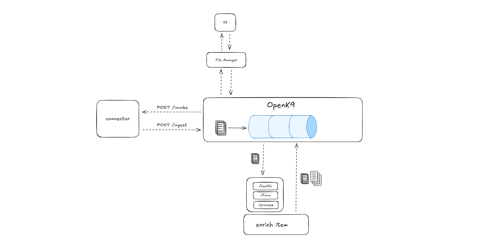

# Archetype

This Maven archetype generates a base enricher for OpenK9, built with Quarkus.



It provides a custom library from **enricher-openapi-server** module, to know what the library implements [click here](../enricher-openapi-server).

## How to Develop a New Enricher

There are some specifications you need to follow when developing a new OpenK9 Enricher:

### Implementation of Library Classes

These classes implement the REST classes from the library and adapt their behavior for the enricher.

- **HealthResourceImpl.java**   
  It exposes `/health` endpoint used from OpenK9 to get the status of enricher.
   ```json
   {
     "status": "UP"
   }
   ```


- **ProcessResourceImpl.java**  
  It exposes `/process` endpoint, it is invoked from OpenK9 to start the enrichment of data.
  ```json
  {
    "payload": {
      "contentId": "8e581f12-eb61-33b4-945e-19c3749fe66d",
      "datasourceId": 104,
      "tenantId": "demo",
      "rawContent": "Text of the document",
      "resources": {
        "binaries": [
          {
            "id": "4f24558d-a312-3ff4-a6c4-ee09582f5421",
            "name": "report.pdf",
            "contentType": "application/pdf",
            "resourceId": "3CB769de-1dEf-bc87-2aeE-Bacfe2FF5Df4"
          }
        ]
      }
    },
    "enrichItemConfig": {},
    "replyTo": "1577489"
  }
  ```
  `payload` is the document being indexed, with the other fields set by the connector and by the enrichers before this one.
  OpenK9 takes the payload returned by the enricher as the new document, so the result of the enrichment goes into the payload.  
  Each binary can be read from the file manager with `ByteArrayClient` or `Base64Client`, by its `resourceId` and,
  as `schemaName`, the `tenantId` of the document.  
  When the enricher comes after Tika in the pipeline, turn on `retain_binaries` in the Tika enrich item:
  otherwise Tika deletes each binary from the file manager after reading it, and this enricher finds none.  
  `replyTo` is set only for async enrichers: it is the token to send back with the enriched payload.


- **FormResourceImpl.java**  
  It exposes `/form` endpoint that returns the form representation of the enricher configuration.
  ```json
  {
    "fields": [
      {
        "info": "Field of the document where the enricher writes its result",
        "label": "Target Field",
        "name": "targetField",
        "type": "text",
        "size": 6.0,
        "required": true,
        "values": [
          {
            "value": "enrichExample",
            "isDefault": true
          }
        ]
      },
      {
        "info": "Content types of the binaries to read; none to read them all (example field, not read by the code)",
        "label": "Content Types",
        "name": "contentTypes",
        "type": "multiselect",
        "size": 6.0,
        "required": false,
        "values": [
          {
            "value": "application/pdf",
            "isDefault": true
          },
          {
            "value": "text/plain",
            "isDefault": false
          },
          {
            "value": "text/html",
            "isDefault": false
          },
          {
            "value": "image/png",
            "isDefault": false
          }
        ]
      },
      {
        "info": "Largest binary to read, in megabytes (example field, not read by the code)",
        "label": "Max Binary Size (MB)",
        "name": "maxBinarySize",
        "type": "number",
        "size": 4.0,
        "required": false,
        "values": [
          {
            "value": 10,
            "isDefault": true
          }
        ],
        "validator": {
          "min": 1,
          "max": 100
        }
      },
      {
        "info": "Read the binaries from the file manager; when off, only their names are listed",
        "label": "Read Binaries",
        "name": "readBinaries",
        "type": "checkbox",
        "size": 4.0,
        "required": false,
        "values": [
          {
            "value": true,
            "isDefault": true
          }
        ]
      }
    ]
  }
  ```

### Enricher Base Classes

These base classes are required in all enrichers.

- **CallBackClient.java**  
Class used by async enrichers to send the enriched payload to OpenK9, as `{"payload": ...}`,  
with the token received in `replyTo` to notify OpenK9 which document the payload refers to.

- **ByteArrayClient.java**  
Class used to get a binary from the file manager as a byte array.  
It needs the `resourceId` of the binary and, as `schemaName`, the `tenantId` of the document.

- **Base64Client.java**  
Class used to get a binary from the file manager as a base64 string.  
It needs the `resourceId` of the binary and, as `schemaName`, the `tenantId` of the document.

---

## Install

To install the archetype and the custom library, go to the root of the project and write:

```shell
./mvnw -f quarkus-base-enricher/pom.xml install
```  

## Generate Enricher

To generate the enricher, write one of these commands:

### Linux

```shell  
mvn archetype:generate                      \
-DarchetypeGroupId=io.openk9.enrichers      \
-DarchetypeArtifactId=archetype             \
-DarchetypeVersion=1.0.0-SNAPSHOT           \
-DgroupId=<my.groupId>                      \
-DartifactId=<my-artifactId>                \
-DimplementationType=<async|sync>           \
-Dversion=<myVersion>                       
```

### Windows (PowerShell)

```shell  
mvn archetype:generate `
"-DarchetypeGroupId=io.openk9.enrichers" `
"-DarchetypeArtifactId=archetype" `
"-DarchetypeVersion=1.0.0-SNAPSHOT" `
"-DgroupId=<my.groupId>" `
"-DartifactId=<my-artifactId>" `
"-DimplementationType=<async|sync>" `
"-Dversion=<myVersion>"
```

In these commands, you need to specify the full information about the archetype you want to use (its `groupId`, its `artifactId`, its `version`)
and the information about the new project you want to create (`artifactId`, `groupId`, `implementationType` and `version`).

## Docker

When you build the generated project, a Docker image is automatically created with its name and tag derived from the `artifactId` and `version`.
If you want to change the image name or disable image generation, you can configure these options in the _application properties_.

## Modify Enricher

After generating it, changes need to be made to the enricher to create a concrete implementation:

1. Update `FormResourceImpl` to get configuration from OpenK9 for your enricher;
   ```java
      // Setting up a FormField example
      private List<FormField> getFormFieldList() {
          List<FormField> formFieldList = new ArrayList<>();

          FormField formField = new FormField();
          formField.setInfo("Read and reply to datasource messages");
          formField.setName("readAndReply");
          formField.setLabel("Read and Reply");
          formField.setRequired(true);
          formField.setSize(6.0);
          formField.setType(FormField.Type.TEXT);
          formField.setValidator(getValidator());
          formField.setValues(getFiledValueList());
          formFieldList.add(formField);
          return formFieldList;
      }

      private FormFieldValidator getValidator() {
          FormFieldValidator formFieldValidator = new FormFieldValidator();
          formFieldValidator.setMin(0L);
          formFieldValidator.setMax(100L);
          formFieldValidator.setRegex("/[[:datasource]]");
          return formFieldValidator;
      }

      private List<FieldValue> getFiledValueList() {
          List<FieldValue> formFieldValueList = new ArrayList<>();
          FieldValue formFieldValue = new FieldValue();
          formFieldValue.setIsDefault(false);
          formFieldValue.setValue("datasource1");
          formFieldValueList.add(formFieldValue);
          return formFieldValueList;
      }
   ```
2. Update the file manager host and port in _application.properties_ to reach the OpenK9 file manager and, in an async
   enricher, the callback host and port to reach the OpenK9 datasource;
3. Replace the example enrichment in `ProcessResourceImpl` with your logic: read what you need from the payload,
   the binaries through `ByteArrayClient` or `Base64Client`, and add your result to the payload.
   The values set in the enrich item for the fields of `FormResourceImpl` arrive in `data.getEnrichItemConfig()`:
   the example reads `targetField` and `readBinaries`, while `contentTypes` and `maxBinarySize` are example fields only;
   ```java
    private Payload enrich(Payload payload, EnrichItemConfig config) {
        // Read the document, e.g. its text or its binaries from the file manager
        Object rawContent = payload.getAdditionalProperties().get("rawContent");
        // Add the result to the payload, in the field set in the enrich item: OpenK9 takes it as the new document
        payload.setAdditionalProperty(targetField(config), Map.of("length", String.valueOf(rawContent).length()));
        return payload;
    }
   ```
4. Keep the `process` method of your implementation type: a sync enricher returns the enriched payload,
   an async enricher accepts the request at once and sends the enriched payload through `CallBackClient` when it is ready.
   ```java
    // sync
    @Override
    public ProcessResponseDTO process(@NotNull OpenK9Input data) {
        ProcessResponseDTO responseDTO = new ProcessResponseDTO();
        responseDTO.setPayload(enrich(data.getPayload(), data.getEnrichItemConfig()));
        return responseDTO;
    }
   ```

   ```java
    // async
    @Override
    public ProcessResponseDTO process(@NotNull OpenK9Input data) {
        if (data.getReplyTo() == null || data.getReplyTo().isEmpty()) {
            throw new IllegalArgumentException("replyTo is null or empty");
        }
        vertx.executeBlocking(() -> enrich(data.getPayload(), data.getEnrichItemConfig()), false)
                .onSuccess(payload -> callBackClient.callback(payload, data.getReplyTo()))
                .onFailure(e -> LOGGER.error("Error enriching data", e));
        ProcessResponseDTO responseDTO = new ProcessResponseDTO();
        responseDTO.setPayload("OK");
        return responseDTO;
    }
   ```
